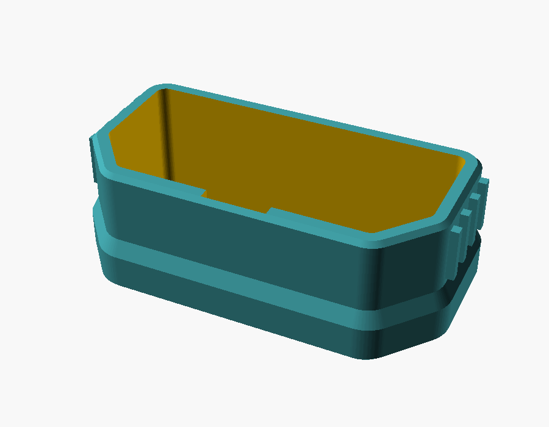
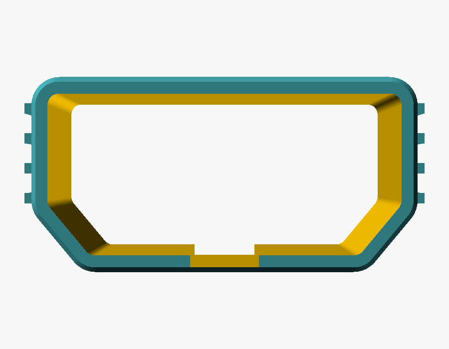

# OBD2 scan-tool plug TPU bumper sleeve

A TPU sleeve that stretches over the **outside** of the black OBD2 (J1962) plug shroud on a scan tool
(made for the GM MDI 2 cable). The **front face is left fully open**, so the pins and the mating opening
aren't covered and the plug still slides over the vehicle port.

 

## Files
- `obd2_tpu_protector.scad`: the parametric source (OpenSCAD, Customizer-friendly)
- `obd2_tpu_protector.stl`: ready to print with the defaults

## Dimensions
| | Value |
|---|---|
| Shroud width (measured) | 41.93 mm |
| Shroud height (measured) | 19.60 mm |
| Fit | 0.20 mm/side interference (stretch fit) |
| Main wall | 2.0 mm |
| Front bumper band | 3.0 mm wall × 5 mm long, chamfered edge |
| Sleeve length | 16 mm back from the front face |
| Outer size (bumper) | ~47.1 × 24.8 mm |

**Check before printing:** the angled lower-corner size (`chamfer_x` / `chamfer_y`), how much straight shroud
there is behind the front face (`sleeve_len`), and the bottom key tab (`tab_w`). These were estimated from photos.
Print one at 5 mm `sleeve_len` first to check the fit quickly.

## Printing
- TPU 95A, 0.4 mm nozzle, 0.2 mm layers, 20–30 mm/s, retraction low or off
- 4 walls (the 2 mm wall then prints solid), no supports
- The STL is already oriented front-end down; print it that way

## Tuning
- Too tight or too loose: change `fit_per_side` (-0.1 is looser, -0.3 is tighter)
- Port sits in a tight dash recess: reduce `front_band_w` to 2 (or equal to `wall`)
- Want more front-edge protection and the port sticks out from the panel: set `front_proud = 0.5`
